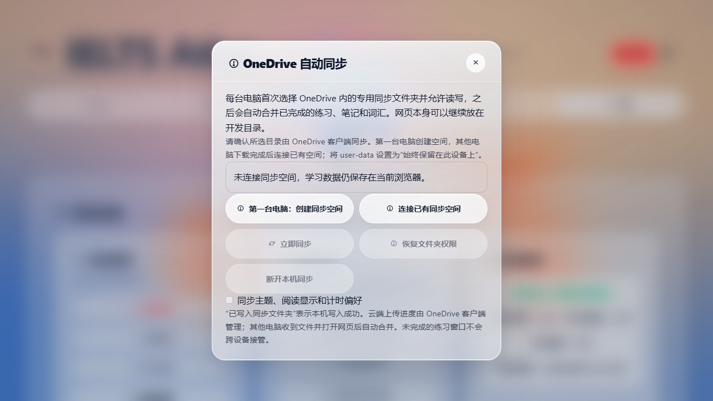

# OneDrive sync verification: deployment branch

Date: 2026-11-09 (Asia/Shanghai).

Base: `feature/multi-device-easy-deploy`, commit `3099bfce5d13a331b84c86e1de5543381ad265ab`.

This is a focused port of the earlier static-edition prototype. It does not merge the newer static branch's history, question assets, diagnostics framework or vocabulary / practice-review modules into this branch.

## Executed checks

Windows; Node.js v24.16.0; npm 11.13.0. Dependencies were installed locally with each existing lockfile: developer Playwright 1.56.1 and the existing backend dependencies. The sync browser tests prefer installed Chrome / Edge, falling back to Playwright Chromium.

| Check | Result |
|---|---|
| `npm --prefix developer test` | 126 passed, 0 failed, 0 cancelled, 0 skipped |
| `npm --prefix developer run test:sync` | 26 sync tests are included in the full suite; also runnable separately |
| `npm --prefix backend test` | 5 passed, 0 failed, 0 skipped |
| `npm --prefix developer run test:sync:backend` | 1 passed; production backend HTTP entry, panel, CSS and automatic publication |
| `node scripts/build-bundles.mjs --check` | Passed: 14 outputs current |
| `git diff --check` | Passed |
| `D:/Dev/Runtimes/Python/3.12.10/python.exe -X utf8 developer/tests/ci/run_static_suite.py` | Not passed: 3 existing OneDrive guard mismatches and 5 checks blocked by missing Python Playwright |

The build reports the branch's existing eight duplicate-symbol warnings. No dependency lockfile, backend route, SQL migration, deployment configuration or question asset was changed.

## Scope demonstrated

- Canonical JSON SHA-256, independent offline attempts, duplicate / reordered operations, concurrent annotations, tombstones and bulk-delete confirmation.
- Atomic outbox rollback and durability across reloads using real IndexedDB; receiving operations does not generate a local echo.
- Real origin-private FileSystemDirectoryHandle read/write, persistent binding, queued delivery after reload, permission loss, truncated local files and malformed remote files.
- Vocabulary word union, causal removal and complete alternatives for concurrent word review-state edits on this branch's existing vocabulary schema.
- Built pages over file:// and HTTP, including the production backend entry. Tests accept the first-run notice through the UI and observe automatic publication after completing a synthetic attempt.
- Rejection of the newer static prototype's protocol format, so incompatible schemas cannot silently share one workspace.

Tests use isolated browser contexts and synthetic data. Directory selection is substituted with a real origin-private directory; log copying simulates OneDrive transport. The backend integration uses in-memory auth, session and record stores.

## Immediate startup recovery and consistent action notices (2026-11-09)

The runtime starts reading the saved binding alongside AppData readiness as soon as it loads, and performs the initial sync pass before completing initialization. It no longer waits for DOMContentLoaded or a scheduled timer. Permission recovery starts on ordinary mouse/keyboard/touch activation without opening settings, including permission loss after setup in the same visit. Requests are coalesced and their trailing click cannot duplicate a SecurityError retry. Actual denial and explicit disconnect remain respected.

Enable, restore, immediate sync, disconnect and preference actions reuse shared success/error notices. Recovery has an explicit pending state that suppresses obsolete warning notices. A later verified pass removes stale errors from earlier manual actions and leaves unrelated notices intact.

Two new source browser regressions verify publication while the document is still loading, and mouse-down/keyboard recovery without a settings entry. The production HTTP regression verifies home-page reload and permission recovery before a click completes, queued publication, unchanged space identity, no directory reselection, shared success notices, stale manual-error cleanup with and without a newer backup notice, and remaining malformed-log error reporting. Existing file:// release coverage and reset/queue/denial regressions passed in the frontend suite. Native folder dialogs, native persistent file:// grants and physical two-device OneDrive transfer remain unverified.

Local evidence: ignored developer/doc/onedrive-sync-startup-{frontend,http,static}.log files. No dependencies, backend APIs, protocol or shared page layout changed.

The additional static aggregation was run with the existing base Python because `python` on PATH is a Windows Store alias. Its CSS allowlist rejects the existing folder-sync.css, its architecture guard rejects the existing adapter's IndexedDB access and reset-harness reference, and its settings-button configuration lacks the existing folder-sync entry. Those files/references are present in the pre-change HEAD; this patch does not change them. Five embedded Python browser checks, including full_reset_flow.py, could not run because this project has no Python Playwright environment. No interpreter, PATH or dependency installation was changed to work around this. The static aggregation is not reported as passing; the Node/Playwright sync, reset and production-page regressions above passed.

## PR #282 review regressions

The unified **启用 OneDrive 同步** entry detects a project root or the legacy user-data directory. Creation requires complete project-root entries, no existing sync directory and explicit confirmation. Missing/truncated/incompatible markers stop safely. Confirmation-time folder arrival is rechecked, known local space identities prevent replacement initialization, and existing marker bytes / space IDs are preserved. The browser cannot establish OneDrive cloud download completeness when no local sync directory is visible; the confirmation explicitly requires first-ever use and a completed download.

The five added browser regression tests cover:

- An old-client empty vocabulary seed followed by a word edit; an empty joining client emits no default operation and receives the word without conflict. A joining client with pre-existing words and a practice attempt preserves and merges both.
- Existing root and direct user-data connection, declined initialization, partial / empty / malformed / incompatible markers, and directory arrival during confirmation.
- A real second tab attempting a learning commit while reset is paused in external-backup preparation. The system-store barrier aborts that transaction; previously accepted records have already been published before database deletion.
- Refused reset with an unpublished outbox and failed reset preparation; data survives and writes resume after barrier release.
- A rejected AppData readiness promise with no folder binding versus an existing binding: unbound site reset succeeds; bound reset stops without deleting the binding.

Permission restoration is exercised through reauthorize with an origin-private handle. Real permission prompts and OneDrive transfer remain manual cases. The panel screenshot was regenerated from the production backend-served page. Evidence is saved locally in ignored developer/doc/onedrive-sync-review-{all,focused,backend,http,build,bundle-check}.log files.

## Permission recovery interaction update

The panel now shows only **启用 OneDrive 同步** before setup. Connected, authorized browsers see **自动同步已开启** with sync/disconnect/preferences controls and no setup/recovery button. When permission expires, **同步已暂停** and **恢复同步** appear; immediate sync is disabled until access is restored. Disconnect returns to setup. Conflict and bulk-deletion controls remain available.

The production backend browser test now verifies these real rendered states, denies one simulated browser permission request (queue retained), grants the next request (queue drains automatically), verifies that recovery does not reopen the directory picker or change the space ID, and disconnects/reconnects without losing the practice record. Only the browser permission results and directory chooser are substituted; production service, IndexedDB and file writing code execute unchanged. The initial panel screenshot was regenerated and visually inspected.

Rerun commands use the existing dependency lockfiles: frontend suite (121 tests including 21 sync tests), focused sync, backend (5 tests), production HTTP browser integration (1 extended test), bundle build/check and git diff check. Local evidence is saved in ignored developer/doc/onedrive-sync-ui-*.log files. No dependency, storage protocol, data-write barrier or backend API changes are included in this UI update.

## Settings-only sync UI

Removed the sync worker status subscription's global banner creation; it no longer inserts an “打开同步面板” button or changes the application's shared banner stack. The existing Settings → Data management entry is the sole UI entry. Permission, conflict, bulk-deletion and file-error information remains in that panel, with attention states on its settings entry. Action errors are retained inside the panel. The later shared-notification update below also reports them through the existing backup notification system.

The production HTTP browser regression now pauses sync by simulating permission loss, visits overview/browse/practice/more, and asserts that no global sync button/banner exists and the settings entry/modal is not visible there. Original navigation/overview labels and controls are compared before/after. It returns through Settings → Data management to verify permission denial feedback and recovery without data loss. Runtime source changes are confined to syncPanel.js and its generated bundle; index.html, original page sections and shared layout/CSS are unchanged. Evidence: developer/doc/onedrive-sync-settings-*.log (ignored local files).

## Shared backup-style sync notifications

Sync permission loss, conflicts, pending bulk-deletion confirmation and file errors now call the existing showMessage notification used by disk backup. These are transient text notices directing users to Settings → Data management; no separate banner container, home-page button or global shortcut is created. Identical ongoing attention states do not repeat on each polling refresh. Action errors use the same shared error notification and remain visible in the sync panel.

The production HTTP browser test verifies the shared warning/error notification DOM, absence of notification buttons, unchanged-state deduplication and the existing navigation/overview controls. It visits overview/browse/practice/more while permission is unavailable and confirms the only sync settings entry remains under Settings → Data management. No index.html, shared stylesheet, original section markup, service or data protocol changes were made. Executed checks: 121 frontend tests (including 21 sync tests, also run separately), 5 backend tests, 1 production HTTP browser test, 14 current bundle outputs and git diff check all passed. Evidence: ignored developer/doc/onedrive-sync-notices-*.log files. The [overview screenshot during permission loss](onedrive-sync-notices-overview.png) was captured at 1901 × 908 and visually inspected: original sections remain, the lower-left sync button is absent, and the reminder uses the shared backup notification.

## Automatic return to an existing binding

Startup now reports restoration in progress until persisted state and directory permission have loaded. Valid grants resume background synchronization immediately. On returning pages with a session-only prompt, one trusted normal click synchronously requests the saved handle permission; it does not open the folder chooser, intercept the user's practice action or re-create a space. A denied request is not retried automatically again during the visit; explicit disconnect is respected. Browser-required consent cannot be bypassed. Chrome's persistent permission option, when offered, is explained in the settings panel and usage guide.

Latest rerun: **123 frontend tests**, **23 focused sync tests** (included in 123), **5 backend tests**, **1 production HTTP browser integration**, **14 current bundle outputs** and git diff check all passed.

Two new tests exercise returning-page trusted vs synthetic clicks, grant/denial, at-most-once requests, queue retention and disconnect; and close/relaunch of a real persistent Chromium profile with an origin-private directory handle and a queued record. The latter verifies automatic publication with unchanged writer/space identity and no connect/restore call. The built backend page test also reloads and publishes a new practice record without reconfiguration. Native user-folder permission dialogs, file:// persistent-grant behavior and real OneDrive transfer remain unverified; these tests do not claim those results. Evidence: ignored developer/doc/onedrive-sync-resume-*.log files.

References: [Chrome persistent permissions](https://developer.chrome.com/blog/persistent-permissions-for-the-file-system-access-api) and [requestPermission user-activation requirement](https://developer.mozilla.org/en-US/docs/Web/API/FileSystemHandle/requestPermission).

## First-interaction race and stale notification recovery

The returning-page activation listener is registered before asynchronous initialization. A trusted click during startup is retained while its browser activation remains live. Busy worker checks no longer discard the first click: permission is requested synchronously, the old worker finishes, and a new sync pass runs with the grant. SecurityError leaves the next trusted click eligible; a real denial does not repeat automatically. No browser security policy is bypassed.

The sync panel retains the DOM handle of each notification it owns. Once its attention state clears, that exact stale notice is dismissed using the shared MessageCenter; a later disk-backup notification remains untouched. In-progress worker emissions no longer produce intermediate stale-error notices. Granting permission clears prior permission errors and performs a fresh sync check; real file errors still surface if they persist.

Regressions cover delayed binding initialization, clicks during an active permission query, retry after SecurityError, a real malformed operation file followed by repair, automatic removal of the stale error notice, and preservation of an unrelated backup success notice. Latest rerun: 124 frontend tests (including 24 sync tests, also run separately), 5 backend tests, 1 extended HTTP browser test, 14 current bundle outputs and git diff check all passed. The [recovered settings screenshot](onedrive-sync-recovered.png) was visually checked: the entry shows enabled and the stale error notice is absent. Evidence: ignored developer/doc/onedrive-sync-recovery-*.log files. Native user-folder dialogs and the user's file:// permission persistence remain unverified; the existing real persistent-profile restart regression uses origin-private directory handles.

## Pending external validation

Real OneDrive upload/download, two physical computers, Files On-Demand and actual directory reauthorization still require [manual acceptance](OneDrive-Sync-Manual-Test.md). No personal browser database or OneDrive account was used.

Python tests, the complete Python browser suite, Node.js 22/Linux coverage, Docker/PostgreSQL persistence and deployment smoke were not executed locally in this run. The existing Multi-device CI must be read separately; local checks do not establish its result.

The earlier static-branch results (853 tests / Playwright 1.62.1 / 18 build outputs) do not describe this port.

## Reproduce

Follow the lockfile installation and browser setup in [ONEDRIVE_SYNC.md](../../ONEDRIVE_SYNC.md). Run the commands above from the repository root. Raw logs are local evidence and are not committed; reviewers should save their own results.

